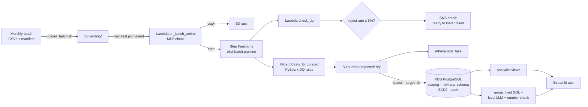
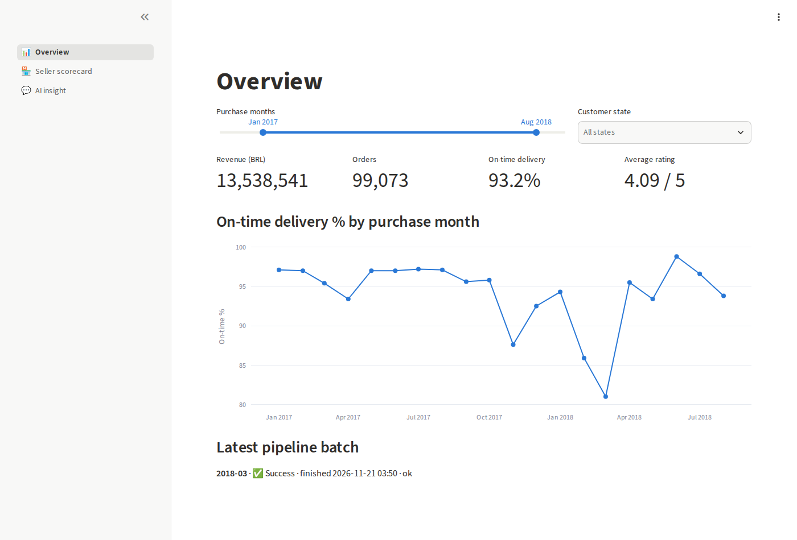
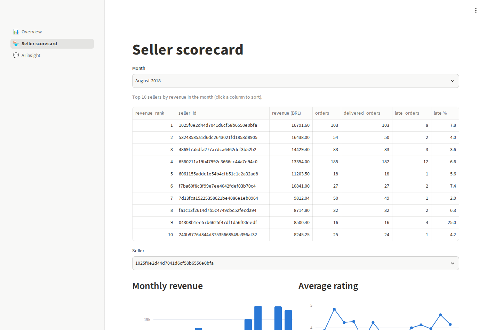
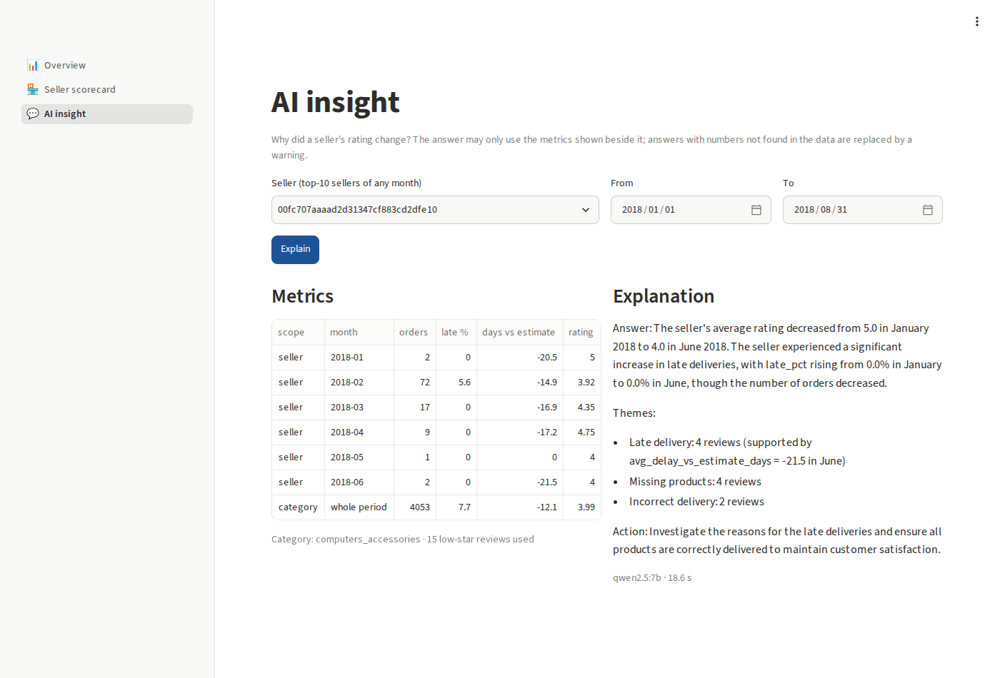

# Olist Seller Performance Pipeline

A small, end-to-end data pipeline on AWS that turns Olist's raw marketplace order files into a data lake, a PostgreSQL star-schema warehouse, a dashboard, and a grounded AI explanation of why sellers' ratings change.

## Problem

Olist is a Brazilian marketplace where many small sellers sell products. Late deliveries cause bad reviews, but managers cannot easily see which sellers and states cause delays, and nobody reads the thousands of written complaints. The data sits in 9 separate CSV files designed for running the shop, not for analysis.

**Users**
- Operations manager: on-time delivery by state and month.
- Seller-success team: seller scorecards and the reasons behind bad ratings.

**Data:** [Brazilian E-Commerce Public Dataset by Olist](https://www.kaggle.com/datasets/olistbr/brazilian-ecommerce) (~100k anonymised orders, 2016–2018). The CSVs are not included in this repo; download them into `data/source/`. `tools/make_batches.py` replays them as 9 monthly batches (2017-12 holds everything before 2018), with 10 simulated seller moves and 7 deliberately bad rows.

## Architecture



Warehouse: two facts (`fact_order_item` per item, `fact_order_fulfilment` per order as an accumulating snapshot),
`dim_seller` as SCD Type 2, `dim_customer`/`dim_product` as SCD Type 1, a role-playing `dim_date`, and
`audit` tables for batches, DQ results, reconciliation and errors ([design](docs/warehouse_design.md)).

## Tech stack

| Layer | Tools |
| --- | --- |
| Lake and ingestion | S3 (versioned, encrypted, lifecycle), Lambda (Python 3.12), Athena |
| Transform | PySpark 3.5 — locally and as an AWS Glue 5.0 job (same script) |
| Orchestration and alerts | Step Functions (Standard), SNS email |
| Warehouse | PostgreSQL 16 — Docker locally, RDS `db.t4g.micro` on AWS; PL/pgSQL load procedures |
| Analytics and app | SQL views, Streamlit, Plotly |
| GenAI | Ollama `qwen2.5:7b` locally; Bedrock Converse as a drop-in swap |
| Quality | `unittest` (rules, manifest check, number check, rerun idempotency), GitHub Actions |

## Run locally

Needs Python 3.11, Java 17, Docker; on Windows use WSL.

```bash
python3.11 -m venv .venv && . .venv/bin/activate && pip install -r requirements.txt
cp .env.example .env                                   # fill in PG_PASSWORD (and the AWS/RDS values later)
docker run -d --name olist-pg -e POSTGRES_PASSWORD=<pw> -p 5432:5432 postgres:16
docker exec olist-pg psql -U postgres -c "CREATE DATABASE olist"
cat sql/ddl/*.sql sql/procedures/*.sql | docker exec -i olist-pg psql -U postgres -d olist -v ON_ERROR_STOP=1

python -m tools.make_batches                           # data/source/*.csv -> data/batches/batch_id=*/
for b in $(ls data/batches | sed 's/batch_id=//'); do  # in date order
  python -m transform.raw_to_curated --batch_id $b --input data/batches/batch_id=$b --output data/lake
  python -m loader.curated_to_warehouse --batch $b
done
python -m tools.run_analytics                          # docs/results/*.csv + validation checks
python -m unittest discover tests

ollama pull qwen2.5:7b                                 # https://ollama.com
streamlit run app/streamlit_app.py
```

## Deploy to AWS

Region `ap-southeast-2`; set `S3_BUCKET`, `ALERT_EMAIL` and the `RDS_*` values in `.env`, then:

```bash
set -a; . ./.env; set +a
bash infra/setup_aws.sh        # bucket, IAM roles, Lambdas, Glue job, SNS, Step Functions, Athena workgroup
bash infra/setup_rds.sh        # RDS instance + security group (your IP only); put the endpoint in RDS_HOST
bash infra/init_rds_db.sh      # DDL, procedures, views, etl_writer / app_reader users
bash tools/run_all_batches.sh  # each batch: upload -> pipeline -> email -> load into RDS
python -m tools.athena_query sql/athena/curated_tables.sql
WAREHOUSE=app streamlit run app/streamlit_app.py      # app reads RDS as app_reader
```

All scripts are rerun-safe. Details: [AWS setup](docs/aws_setup.md), [RDS setup](docs/rds_setup.md).
Confirm the SNS subscription email once. Stop RDS when idle (`aws rds stop-db-instance --db-instance-identifier olist-warehouse`).
When finished, `CONFIRM=delete bash infra/teardown_aws.sh` deletes every resource (irreversible).

## Results

| Area | Target | Result |
| --- | --- | --- |
| Ingestion | every batch passes the manifest check | 9/9 "manifest OK"; a manifest with missing files is refused and nothing is copied |
| Data quality | every injected bad row rejected with a reason | 2018-02: exactly the 7 injected rows (3 duplicate_key, 2 null_key, 2 non_positive_price); also 23 real `delivered_before_shipped` orders and their 50 items, 23 reviews |
| Broken input | a bad file fails loudly | renamed column → Glue fails at RawToCurated → failure email |
| Load accuracy | 0 difference in counts and price totals | 0 for all 9 batches on RDS (`audit.reconciliation`); RDS row counts equal the local warehouse |
| Idempotency | rerunning a batch changes nothing | integration test + rerun on RDS: all counts unchanged |
| SCD Type 2 | one new version per simulated move | 10 moves → 10 sellers with exactly 2 versions; facts point to the version valid on the purchase date |
| SQL | six queries run; validation finds nothing | Q1–Q6 on RDS in [`docs/results/`](docs/results) (identical to local); 4 validation queries return 0 rows |
| Performance | one measured improvement | seller scorecard query 11.3 ms → 1.6 ms with `(seller_key, purchase_date_key)` |
| Athena | scan little | items and revenue for all 9 batches: 238 KB scanned; totals equal the warehouse (112,600 items) |
| GenAI | 5/5 hand-checked answers traceable | **4/5** (one real number attached to the wrong month); see below |
| Code | all unit tests pass | 20 tests, GitHub Actions green |

Some answers to the business questions ([details](docs/analytics.md)): on-time delivery was ~97% for most of 2017,
dipped to 87.6% (Nov 2017) and 81.0% (Mar 2018 purchases), then recovered to 93–99%; 62.7% of late `bed_bath_table` orders got a 1–2 star review; only 3.12% of customers
ordered more than once.

### GenAI evaluation

`explain_seller(seller_id, start, end)` answers "why did this seller's rating change?" from two fixed queries and
up to 30 low-star review texts. Checked by hand on 5 sellers ([docs/genai_eval.md](docs/genai_eval.md)): headline
numbers (first/last month rating and late %) were correct in 5/5 and the main complaint themes were found, but in
one answer a real value was attached to the wrong month and theme counts are approximate. The number-check guardrail
replaces any answer containing a number not found in the data (it caught invented numbers from the 3B model); it
cannot catch a right number in the wrong place, so the app always shows the metrics beside the answer.

### Screenshots

| Overview | Seller scorecard | AI insight |
| --- | --- | --- |
|  |  |  |

## Limitations and future work

- **Warehouse load is one manual command** after the success email; automating it needs Glue in the VPC (see [decisions](docs/decisions.md)).
- **Small local LLM**: theme counts are approximate and the number check cannot verify which month a number belongs to. Next: classify reviews into fixed themes deterministically and pass counts to the model; use a larger hosted model when Bedrock quota is available.
- **Payments** (`olist_order_payments`) are not modelled; revenue is item price without freight.
- **Seller cities are free text** (`sao paulo`, `sao paulo - sp`, ...); a city clean-up table would merge them.
- Not built: text-to-SQL questions, Redshift for larger volumes, streaming ingestion instead of monthly batches.

## Documentation

[Data profile](docs/data_profile.md) · [Source ER diagram](docs/source_er.md) · [Warehouse design](docs/warehouse_design.md) ·
[Decisions](docs/decisions.md) · [Analytics and index experiment](docs/analytics.md) · [GenAI evaluation](docs/genai_eval.md) ·
[AWS setup](docs/aws_setup.md) · [RDS setup](docs/rds_setup.md) · [Changelog](CHANGELOG.md)
