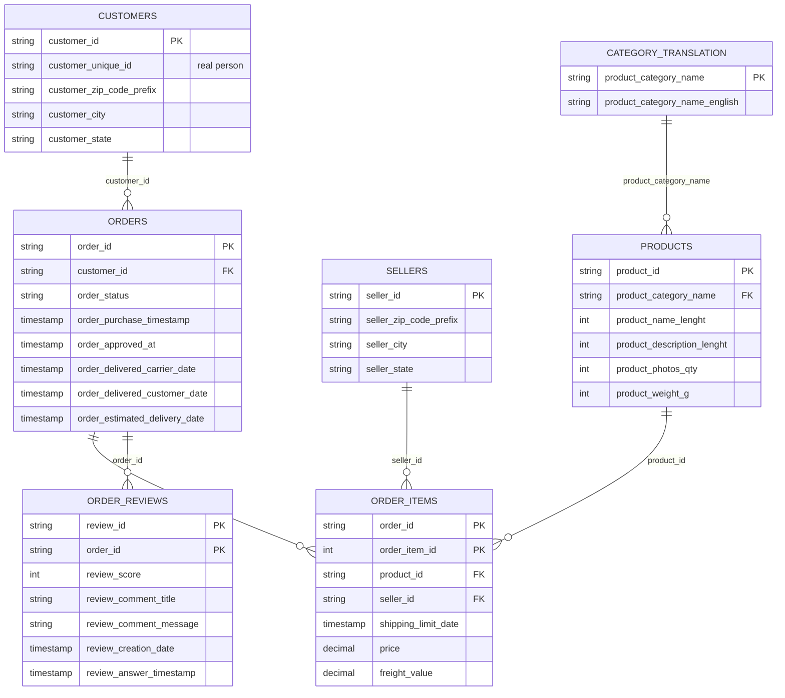

# Source ER diagram

How the 7 source files used in the core version join. `order_payments` and `geolocation` are not loaded.

Notes:
- One real customer (`customer_unique_id`) has a new `customer_id` for every order.
- One review can cover several orders, so a review row is identified by `(review_id, order_id)`.
