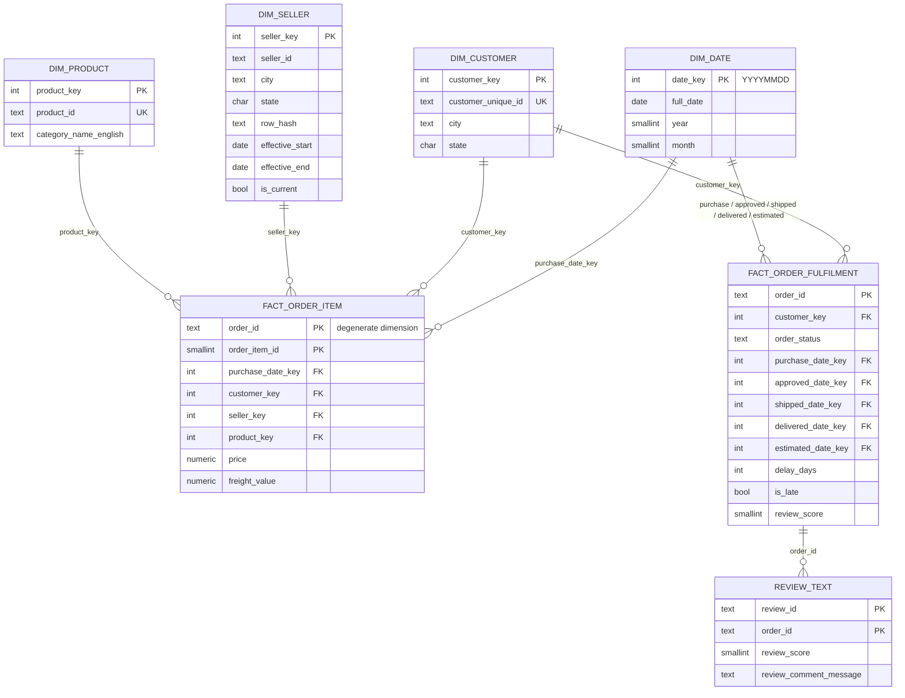

# Warehouse Design

PostgreSQL star schema in three schemas: `staging` (one batch at a time), `dw` (star schema), `audit` (logs). DDL is in `sql/ddl/`, run in file order; every file can be rerun safely.

## Grain

| Table | Type | Grain |
| --- | --- | --- |
| `fact_order_item` | transaction fact | one item in one order |
| `fact_order_fulfilment` | accumulating snapshot | one order, with a date key for each milestone (purchased, approved, shipped, delivered, estimated) |
| `review_text` | supporting table | one review for one order (`review_id`, `order_id`) |
| `dim_date` | role-playing dimension | one calendar day |
| `dim_customer` | SCD Type 1 | one real customer (`customer_unique_id`) |
| `dim_seller` | SCD Type 2 | one version of a seller |
| `dim_product` | SCD Type 1 | one product |

## Star schema

## Decisions

- **Surrogate keys.** Dimensions use integer identity keys; facts store only these keys. Natural keys (`seller_id`, `product_id`, `customer_unique_id`) stay in the dimensions.
- **Unknown rows.** Every dimension has a `-1` row, so fact foreign keys are never NULL. A lookup that fails points to `-1`, which the validation queries in `sql/checks/` count.
- **`dim_seller` is SCD Type 2.** Sellers can move city or state, and a seller's performance must be reported against where they were *at the time of the order* (Q6). A change in `md5(city|state)` closes the current row (`effective_end`, `is_current = false`) and inserts a new version. Facts pick the version whose effective range contains the purchase date. A partial unique index allows only one current row per seller.
- **`dim_customer` and `dim_product` are SCD Type 1.** Customer address history is not needed for any question, and product changes are corrections, so the latest value overwrites.
- **`dim_customer` is keyed on `customer_unique_id`.** The source `customer_id` changes on every order (99,441 ids for 96,096 people).
- **`order_id` is a degenerate dimension.** It has no attributes of its own beyond what the fulfilment fact holds, so there is no `dim_order`.
- **Role-playing `dim_date`.** One date table plays five roles in `fact_order_fulfilment`. Milestones not yet reached point to `-1`.
- **`delay_days` = delivered − estimated, in days; `is_late` = `delay_days > 0`.** Both are NULL when the order was not delivered.
- **`review_score` is the latest review per order.** 551 orders have more than one review.
- **Idempotent loads.** `fact_order_item` rows carry `batch_id`; a rerun deletes that batch's rows before inserting. `fact_order_fulfilment` is upserted on `order_id`.
